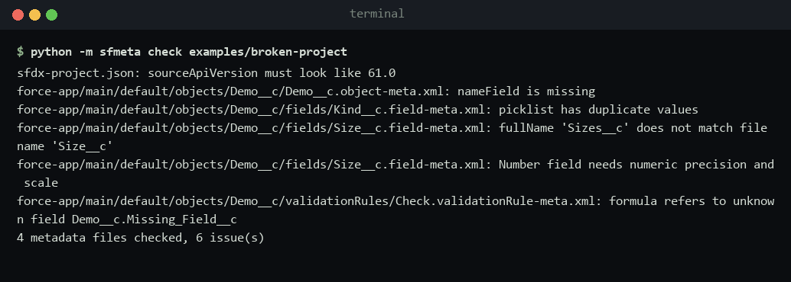

# salesforce-workorder-sample-metadata

A Salesforce DX project with the metadata for a simple facility work order: a custom object, nine fields, a validation rule, a list view, a permission set and a record-triggered flow. Next to it is a Python checker that reads the XML files offline and reports broken names, bad field settings and references to fields that do not exist.



## What it is for

Salesforce admins and facility teams who want to see what a work order data model looks like in source format, or who keep metadata in Git and want a quick check before a deploy. The files are plain sample content, so they are safe to read, copy and change. The checker needs no org and no Salesforce CLI. It does not deploy anything, and a clean result here does not replace a real validation deploy in a sandbox.

## Install

```
git clone https://github.com/yassine2med/salesforce-workorder-sample-metadata
cd salesforce-workorder-sample-metadata && pip install -r requirements.txt
```

## What is in force-app

| Component | File |
|---|---|
| Custom object `Facility_Work_Order__c` (auto number WO-0001) | `objects/Facility_Work_Order__c/Facility_Work_Order__c.object-meta.xml` |
| Fields: Status, Priority (picklists), Description (long text), Building (text), Requested On, Due Date (dates), Estimated Hours (number), Estimated Cost (currency), Is Safety Issue (checkbox) | `objects/Facility_Work_Order__c/fields/` |
| Validation rule: due date cannot be before the request date | `validationRules/Due_Date_After_Request.validationRule-meta.xml` |
| List view: open work orders | `listViews/Open_Work_Orders.listView-meta.xml` |
| Permission set: manager access | `permissionsets/Facility_Work_Order_Manager.permissionset-meta.xml` |
| Before-save flow: set Status to New when blank | `flows/Set_Default_Work_Order_Status.flow-meta.xml` |

## How to use

| I want to | Command |
|---|---|
| Check this project | `PYTHONPATH=src python -m sfmeta check` |
| Check another project folder | `PYTHONPATH=src python -m sfmeta check path/to/project` |
| See the objects and fields found | `PYTHONPATH=src python -m sfmeta inventory` |
| See a project with mistakes | `PYTHONPATH=src python -m sfmeta check examples/broken-project` |
| Show help | `PYTHONPATH=src python -m sfmeta --help` |

Exit codes: 0 when clean, 1 when issues exist, 2 when the folder is missing.

Example:

```
PYTHONPATH=src python -m sfmeta check examples/broken-project
```

Output:

```
sfdx-project.json: sourceApiVersion must look like 61.0
force-app/main/default/objects/Demo__c/Demo__c.object-meta.xml: nameField is missing
force-app/main/default/objects/Demo__c/fields/Kind__c.field-meta.xml: picklist has duplicate values
force-app/main/default/objects/Demo__c/fields/Size__c.field-meta.xml: fullName 'Sizes__c' does not match file name 'Size__c'
force-app/main/default/objects/Demo__c/fields/Size__c.field-meta.xml: Number field needs numeric precision and scale
force-app/main/default/objects/Demo__c/validationRules/Check.validationRule-meta.xml: formula refers to unknown field Demo__c.Missing_Field__c
4 metadata files checked, 6 issue(s)
```

The shipped project:

```
14 metadata files checked, 0 issue(s)
```

Run the tests with `python -m pytest -q`.

## What the checker verifies

1. `sfdx-project.json` parses, has exactly one default package directory that exists, and a `sourceApiVersion` such as `61.0`.
2. Every `*-meta.xml` file is well formed XML, uses the metadata namespace and has the root element its file suffix requires.
3. Fields: the `fullName` matches the file name, ends in `__c` and is at most 40 characters before the suffix. Text needs a length, long text a length and visible lines, number and currency a precision and scale, picklists unique values and at most one default, lookups a target and relationship name, checkboxes a default.
4. Objects have a label, plural label, deployment status, sharing model and name field, and the file name matches the folder.
5. References resolve: validation rule formulas, list view columns and filters, permission set field and object permissions, and flow `$Record` fields and start filters must name fields that exist in the project. Required fields must not appear in a permission set. Flow connectors must point at an element that exists.

## Limits

- The checks are structural and written from the documented source format. Only a deploy to an org can confirm everything, for example formula syntax or org limits.
- Only the file types in the table above are inspected. Other metadata types are ignored.
- Standard fields are not validated, so a list view column such as `NAME` is accepted without checking.

## License

MIT. Yassine Emhamed, 2026.
